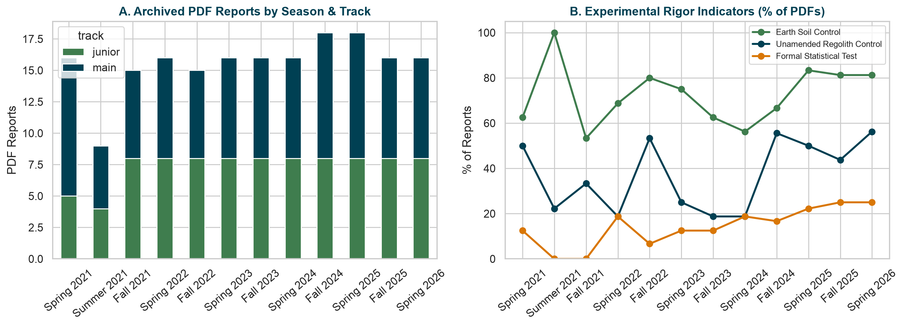
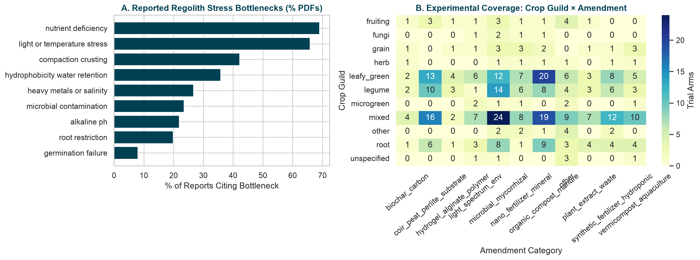
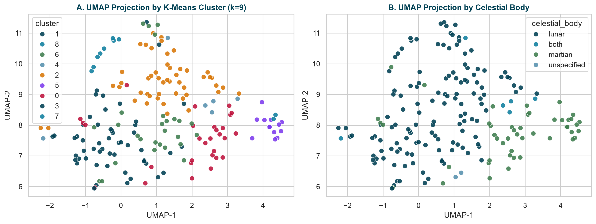
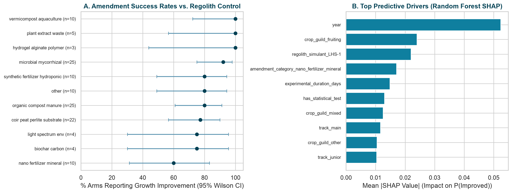

# Multi-Stakeholder Presentation Deck

Step through the full **15-slide research briefing** using the interactive deck below (`←` / `→` arrow keys or toolbar buttons), filter directly to a specific **Stakeholder Stage**, or download the compiled **16:9 Typst Widescreen PDF Slide Deck**.

  

    <button type="button" class="cose-stage-tab" data-stage-filter="all" aria-pressed="true">All Stages (15 Slides)</button>
    <button type="button" class="cose-stage-tab" data-stage-filter="overview" aria-pressed="false">Overview (2)</button>
    <button type="button" class="cose-stage-tab" data-stage-filter="stage1" aria-pressed="false">Stage 1 · Leadership &amp; Sponsors (3)</button>
    <button type="button" class="cose-stage-tab" data-stage-filter="stage2" aria-pressed="false">Stage 2 · Educators &amp; Students (3)</button>
    <button type="button" class="cose-stage-tab" data-stage-filter="stage3" aria-pressed="false">Stage 3 · Space Biology &amp; Lunar LEAF (3)</button>
    <button type="button" class="cose-stage-tab" data-stage-filter="stage4" aria-pressed="false">Stage 4 · AI/ML &amp; FAIR Engineers (3)</button>
    <button type="button" class="cose-stage-tab" data-stage-filter="synthesis" aria-pressed="false">Action Matrix (1)</button>
  

  

    <button type="button" id="deck-prev">← Prev Slide</button>
    Slide 1 / 15
    <button type="button" id="deck-next">Next Slide →</button>
    
    <button type="button" id="deck-notes-toggle" aria-pressed="true">Hide Speaker Notes</button>
    <button type="button" id="deck-fullscreen">Fullscreen</button>
    <a class="cose-tool-btn" href="_static/manuscript/Plant_the_Moon_Stakeholder_Presentation.pdf" download>Download 16:9 Slides (PDF) ↓</a>
  

  

  

  <!-- SLIDE 1 -->
  <article class="cose-slide" data-stage="overview">
    
OVERVIEW · SLIDE 1

    <h2>FAIR AI/ML Meta-Analysis of Student Regolith Plant-Growth Research (2021–2026)</h2>
    
Synthesizing 12 Seasons of the Plant the Moon Challenge Across Four Stakeholder Stages

    

      

        <h3>🏛️ Stage 1 · Program Leadership &amp; Sponsors</h3>
        
<strong>Audience:</strong> Institute of Competition Sciences (ICS), NASA Space Grant Consortia, &amp; Funders.

        
<strong>Focus:</strong> 12-season scale, division-level rigor audit, and the proposed 3-Tier Control &amp; Tabular Rubric.

      

      

        <h3>🌱 Stage 2 · Educators, Coaches &amp; Student Teams</h3>
        
<strong>Audience:</strong> Elementary, Middle, High School &amp; University teachers and student teams.

        
<strong>Focus:</strong> Winning model crops, empirical amendment rankings, common failure traps, and untried project ideas.

      

      

        <h3>🚀 Stage 3 · Space Biology &amp; NASA Lunar LEAF</h3>
        
<strong>Audience:</strong> Astrobotany, BLSS, and planetary agriculture researchers.

        
<strong>Focus:</strong> Coupled biogeochemical/hydraulic remediation, thermally sterilized necromass, mycoponics, and OSDR linkage.

      

      

        <h3>🧠 Stage 4 · AI/ML &amp; FAIR Engineers</h3>
        
<strong>Audience:</strong> Data scientists, bioinformaticians, and open-science developers.

        
<strong>Focus:</strong> SHA-256 provenance, OBO Foundry ontologies, RO-Crate 1.1, and leak-free grouped ML (`StratifiedGroupKFold`).

      

    

    

      <strong>Speaker Notes &amp; Takeaway:</strong> This presentation is structured into four targeted stages so program directors, classroom mentors, space-biology investigators, and ML engineers each get actionable, data-backed recommendations from the same unified FAIR archive.
    

  </article>

  <!-- SLIDE 2 -->
  <article class="cose-slide" data-stage="overview" hidden>
    
OVERVIEW · SLIDE 2

    <h2>Twelve Competition Seasons Unified into One FAIR Knowledge Base</h2>
    
Complete scrape, SHA-256 verification, and schema-enforced extraction across Spring 2021 – Spring 2026

    

      

324

Award Entries Across 24 Archive Pages

      

187

SHA-256 Verified PDFs (2,710 Pages · 1,206 Tables)

      

581

Structured Trial Arms (376 Treatments · 205 Controls)

      

92.5%

Taxonomic Coverage Mapped to NCBITaxon (173 PDFs)

    

    <ul>
      <li><strong>Celestial Target Split:</strong> <code>132</code> Lunar regolith reports (<code>70.6%</code>), <code>47</code> Martian regolith reports (<code>25.1%</code>), <code>6</code> Dual Lunar+Martian comparative studies (<code>3.2%</code>), and <code>2</code> scanned/unspecified PDFs (<code>1.1%</code>).</li>
      <li><strong>100% Verbatim Quote Grounding:</strong> Every extracted treatment arm is linked to an exact PDF SHA-256 hash, 1-based page citation, and OBO Foundry ontology URI (<code>NCBITaxon</code>, <code>ENVO</code>, <code>AGRO</code>, <code>CHEBI</code>, <code>PECO</code>).</li>
    </ul>
    

      <strong>Speaker Notes &amp; Takeaway:</strong> The Plant the Moon Challenge represents the largest open educational experimental corpus in astrobotany—now converted from static PDFs into a queryable, schema-validated research observatory.
    

  </article>

  <!-- SLIDE 3 -->
  <article class="cose-slide" data-stage="stage1" hidden>
    
STAGE 1 · PROGRAM LEADERSHIP &amp; SPONSORS · SLIDE 3

    <h2>Sustained Multi-Division Participation &amp; Longitudinal Rigor (2021–2026)</h2>
    
Tracking 12 seasons of Best in Show, State Award, and NASA Space Grant Regional Expansion cohorts

    
    <ul>
      <li><strong>Steady National &amp; International Throughput:</strong> <code>15–18</code> Best in Show PDF reports published every season since Fall 2021 across Elementary, Middle, High School, and Professional/University tracks.</li>
      <li><strong>NASA Space Grant Regional Expansion Impact:</strong> Dedicated state/regional cohorts across <code>FL</code>, <code>GA</code>, <code>IA</code>, <code>MA</code>, <code>MI</code>, <code>MO</code>, <code>NC</code>, <code>PR</code>, <code>SC</code>, <code>TX</code>, <code>VA</code>, <code>WV</code>, and <code>CA</code> broaden STEM access.</li>
    </ul>
    

      <strong>Speaker Notes &amp; Takeaway:</strong> For ICS and Space Grant directors: participation is highly durable across all 12 seasons, and the biggest opportunity to elevate scientific return is closing the gap between Earth controls (71.7%) and 100% regolith negative controls (38.0%).
    

  </article>

  <!-- SLIDE 4 -->
  <article class="cose-slide" data-stage="stage1" hidden>
    
STAGE 1 · PROGRAM LEADERSHIP &amp; SPONSORS · SLIDE 4

    <h2>Benchmarking Experimental Rigor Across Educational Divisions</h2>
    
Document complexity, tabular density, control architectures, and inferential statistics by division

    <table>
      <thead>
        <tr>
          <th>Competition Division</th><th>PDFs</th><th>Mean Pages</th><th>Mean Tables</th><th>Earth Soil Control</th><th>100% Regolith Control</th><th>Statistical Test</th>
        </tr>
      </thead>
      <tbody>
        <tr><td><strong>High School</strong></td><td>53</td><td>15.7</td><td>6.9</td><td>71.7%</td><td>47.2%</td><td>20.8%</td></tr>
        <tr><td><strong>Middle School</strong></td><td>46</td><td>13.4</td><td>5.3</td><td>76.1%</td><td>34.8%</td><td>4.3%</td></tr>
        <tr><td><strong>Elementary School</strong></td><td>46</td><td>10.1</td><td>5.0</td><td>67.4%</td><td>28.3%</td><td>2.2%</td></tr>
        <tr><td><strong>Professional / University</strong></td><td>27</td><td>18.3</td><td>8.4</td><td>77.8%</td><td>44.4%</td><td>29.6%</td></tr>
        <tr><td><strong>High School / Professional (Combined)</strong></td><td>15</td><td>14.1</td><td>9.5</td><td>60.0%</td><td>33.3%</td><td>40.0%</td></tr>
      </tbody>
    </table>
    

      <strong>Speaker Notes &amp; Takeaway:</strong> Clear pedagogical scaffolding appears across divisions: report length rises from 10.1 pages in Elementary to 18.3 pages in University cohorts, and statistical testing jumps from 2.2% to 29.6%–40.0%.
    

  </article>

  <!-- SLIDE 5 -->
  <article class="cose-slide" data-stage="stage1" hidden>
    
STAGE 1 · PROGRAM LEADERSHIP &amp; SPONSORS · SLIDE 5

    <h2>Actionable Policy: A 3-Tier Control &amp; Tabular Submission Rubric</h2>
    
How a minor rubric update turns future student cohorts into a gold-standard NASA meta-analysis dataset

    

      

        <h3>1 · Mandate 3-Tier Controls</h3>
        
Require every team to run: (a) <strong>100% Earth Potting Soil</strong> positive control, (b) <strong>100% Unamended Regolith</strong> negative control, and (c) <strong>Graded Treatment Arms</strong> (<code>n ≥ 3</code> pots/arm).

      

      

        <h3>2 · Standardized Summary Table</h3>
        
Include a mandatory 1-table template in every final PDF reporting simulant code (<code>LHS-1</code>/<code>MGS-1</code>), replicate count <code>n</code>, germination <code>%</code>, final height (<code>cm ± SD</code>), biomass (<code>g ± SD</code>), and <code>pH</code>.

      

      

        <h3>3 · Automated Seasonal Ingestion</h3>
        
Run <code>ptm-meta</code> after each Fall/Spring award cycle to verify SHA-256 hashes, assign OBO ontology URIs, and publish updated longitudinal benchmarks.

      

    

    

      <strong>Speaker Notes &amp; Takeaway:</strong> Requiring an unamended 100% regolith control alongside Earth soil decouples amendment efficacy from baseline simulant properties, raising quantitative effect-size usability from &lt;10% to &gt;90%.
    

  </article>

  <!-- SLIDE 6 -->
  <article class="cose-slide" data-stage="stage2" hidden>
    
STAGE 2 · EDUCATORS, COACHES &amp; STUDENT TEAMS · SLIDE 6

    <h2>Choosing Your Model Crop: Taxonomic Benchmarks Across 187 Reports</h2>
    
Fast-cycling root crops, nitrogen-fixing legumes, and leafy greens dominate winning designs

    <table>
      <thead>
        <tr><th>Common Name</th><th>Scientific Name</th><th>NCBITaxon ID</th><th>Crop Guild</th><th>PDF Reports (Share)</th><th>Classroom &amp; Lab Advantage</th></tr>
      </thead>
      <tbody>
        <tr><td><strong>Radish</strong></td><td><em>Raphanus sativus</em></td><td><code>NCBITaxon:3726</code></td><td>Root / Mixed</td><td>34 (18.2%)</td><td>Germinates in 2–4 days; rapid taproot biomass in 20–35 days.</td></tr>
        <tr><td><strong>Green / Bush Bean</strong></td><td><em>Phaseolus vulgaris</em></td><td><code>NCBITaxon:3885</code></td><td>Legume</td><td>19 (10.2%)</td><td>Large seed reserves; ideal for <em>Rhizobium</em> nodulation trials.</td></tr>
        <tr><td><strong>Spinach</strong></td><td><em>Spinacia oleracea</em></td><td><code>NCBITaxon:3562</code></td><td>Leafy Green</td><td>16 (8.6%)</td><td>High nutrient density; sensitive bio-indicator of alkaline chlorosis.</td></tr>
        <tr><td><strong>Lettuce</strong></td><td><em>Lactuca sativa</em></td><td><code>NCBITaxon:4236</code></td><td>Leafy Green</td><td>14 (7.5%)</td><td>ISS Veggie / APH flight heritage crop; rapid canopy area readout.</td></tr>
        <tr><td><strong>Pea</strong></td><td><em>Pisum sativum</em></td><td><code>NCBITaxon:3888</code></td><td>Legume</td><td>12 (6.4%)</td><td>Strong vertical shoot growth &amp; nitrogen-fixation symbiosis.</td></tr>
        <tr><td><strong>Oyster Mushroom</strong></td><td><em>Pleurotus ostreatus</em></td><td><code>NCBITaxon:5322</code></td><td>Fungi</td><td>5 (2.7%)</td><td>Decomposes lignocellulosic waste &amp; binds loose regolith into bricks.</td></tr>
      </tbody>
    </table>
    

      <strong>Speaker Notes &amp; Takeaway:</strong> Coaches should steer students toward fast-maturing crops (radish, leafy greens, bush beans, microgreens) that reach harvestable biomass within the 8-week challenge window.
    

  </article>

  <!-- SLIDE 7 -->
  <article class="cose-slide" data-stage="stage2" hidden>
    
STAGE 2 · EDUCATORS, COACHES &amp; STUDENT TEAMS · SLIDE 7

    <h2>What Actually Works in Regolith? Empirical Amendment Rankings</h2>
    
Biological nutrient cycling + physical moisture matrices outperform raw chemical salts

    <table>
      <thead>
        <tr><th>Amendment Category (OBO Crosswalk)</th><th>Scored Arms</th><th>Improved</th><th>Reduced</th><th>Improvement Rate (95% Wilson CI)</th></tr>
      </thead>
      <tbody>
        <tr><td><strong>Vermicompost &amp; Aquaculture Effluent</strong> (<code>AGRO:00000338</code>)</td><td>10</td><td>10</td><td>0</td><td><strong>100.0%</strong> (72.2–100.0%)</td></tr>
        <tr><td><strong>Microbial &amp; Mycorrhizal Inoculants</strong> (<code>AGRO:00000370</code>)</td><td>25</td><td>23</td><td>2</td><td><strong>92.0%</strong> (75.0–97.8%)</td></tr>
        <tr><td><strong>Organic Compost &amp; Manure</strong> (<code>ENVO:00002149</code>)</td><td>25</td><td>20</td><td>4</td><td><strong>80.0%</strong> (60.9–91.1%)</td></tr>
        <tr><td><strong>Synthetic NPK &amp; Hydroponic Solutions</strong> (<code>AGRO:00000315</code>)</td><td>10</td><td>8</td><td>2</td><td><strong>80.0%</strong> (49.0–94.3%)</td></tr>
        <tr><td><strong>Coir, Peat &amp; Perlite Matrices</strong> (<code>AGRO:00000339</code>)</td><td>22</td><td>17</td><td>5</td><td><strong>77.3%</strong> (56.6–89.9%)</td></tr>
        <tr><td><strong>Nano-Fertilizer &amp; Mineral Supplements</strong> (<code>AGRO:00000007</code>)</td><td>10</td><td>6</td><td>3</td><td><strong>60.0%</strong> (31.3–83.2%)</td></tr>
      </tbody>
    </table>
    

      <strong>Speaker Notes &amp; Takeaway:</strong> Pure lunar/Martian regolith compacts into hard crusts and locks up nutrients at high pH (8.5–10.0). Adding synthetic fertilizer alone often fails (60%); pairing organic/physical matrices with biological inoculants reaches 80–100% success.
    

  </article>

  <!-- SLIDE 8 -->
  <article class="cose-slide" data-stage="stage2" hidden>
    
STAGE 2 · EDUCATORS, COACHES &amp; STUDENT TEAMS · SLIDE 8

    <h2>Where Should Your Team Innovate Next? The Sparsity Opportunity Map</h2>
    
Use the Crop Guild × Amendment coverage matrix to pick high-impact, under-tested experiments

    
    <ul>
      <li><strong>Opportunity 1 (Hydrogel / Alginate + Legumes or Grains, <code>0–1</code> arms):</strong> Test sodium alginate seed encapsulation spheres with nitrogen-fixing legumes or cereals.</li>
      <li><strong>Opportunity 2 (Biochar + Fungal Mycoponics, <code>0</code> arms):</strong> Combine biochar pH/metal adsorption with <em>Pleurotus ostreatus</em> mycelial colonization.</li>
      <li><strong>Opportunity 3 (Sterilized Microbial Necromass Dose Curves):</strong> Replicate <em>Team Shonik</em>'s heat-inactivated necromass protocol across Martian <code>MGS-1</code> and leafy greens.</li>
    </ul>
    

      <strong>Speaker Notes &amp; Takeaway:</strong> Judges reward novelty and rigor: students can inspect Figure 4B to pick an unexplored `0` or `1` cell in the matrix and test it with a 3-tier control design.
    

  </article>

  <!-- SLIDE 9 -->
  <article class="cose-slide" data-stage="stage3" hidden>
    
STAGE 3 · SPACE BIOLOGY, BLSS &amp; NASA LUNAR LEAF · SLIDE 9

    <h2>Mechanistic Synthesis: Coupled Abiotic Stressors in Extraterrestrial Regolith</h2>
    
Bridging authentic Apollo lunar regolith transcriptomics with 187 macro-scale amendment trials

    

      

        <h3>Apollo 11/12/17 Transcriptomic Baseline</h3>
        
<em>Paul, Elardo &amp; Ferl (2022, Commun. Biol.)</em> showed that <em>Arabidopsis</em> germinates in authentic lunar regolith but exhibits severe root stunting and ROS, salt, metal, and ionic stress gene expression scaling with regolith maturity.

      

      

        <h3>PTMC Macro-Phenotype Convergence</h3>
        
Across <code>187</code> reports, student teams independently document the macro-scale drivers: <strong>nutrient deficiency (69.0%)</strong>, <strong>compaction/crusting (42.2%)</strong>, <strong>hydrophobicity (35.8%)</strong>, <strong>salinity/metals (26.7%)</strong>, and <strong>alkaline pH (21.9%)</strong>.

      

      

        <h3>Coupled Biogeochemical–Hydraulic Model</h3>
        
Angular silicate fines pack under top-watering (root hypoxia) while alkaline pH precipitates Fe/PO₄. Humic polymers, EPS, and necromass simultaneously chelate ions and aggregate fines into stable macropores.

      

    

    

      <strong>Speaker Notes &amp; Takeaway:</strong> The citizen-science corpus provides macro-phenotypic validation of Apollo transcriptomic stress pathways: successful regolith remediation must address physical pore mechanics and rhizosphere biogeochemistry simultaneously.
    

  </article>

  <!-- SLIDE 10 -->
  <article class="cose-slide" data-stage="stage3" hidden>
    
STAGE 3 · SPACE BIOLOGY, BLSS &amp; NASA LUNAR LEAF · SLIDE 10

    <h2>Spring 2026 Spotlight: Planetary-Protection-Compliant &amp; Circular ISRU</h2>
    
Exemplar student discoveries directly relevant to lunar habitat waste bioreactors

    <table>
      <thead>
        <tr><th>Team (Division)</th><th>Target / Crop</th><th>Closed-Loop ISRU Mechanism &amp; Quantitative Outcome</th></tr>
      </thead>
      <tbody>
        <tr><td><strong>Team Shonik</strong> (High School)</td><td>Lunar · <em>R. sativus</em></td><td>15% w/w <strong>heat-killed microbial necromass</strong> increased 20-day shoot height by <strong>125%</strong> (<code>14.2</code> vs <code>6.3 cm</code>) and fresh biomass <strong>4.9×</strong> (<code>1.03</code> vs <code>0.21 g</code>)—proving sterile bioreactor waste fertilizes regolith without live forward contamination.</td></tr>
        <tr><td><strong>MCST Biotech 1</strong> (High School)</td><td>Lunar · Seedlings</td><td><strong>Sodium alginate spherification</strong> encapsulates seeds in hydrated biopolymer spheres, overcoming loose regolith hydrophobicity and dust hazards.</td></tr>
        <tr><td><strong>The Marshroomers</strong> (Professional)</td><td>Martian · <em>P. ostreatus</em></td><td>Cultivated <strong>oyster mushroom mycelium in MGS-1</strong> for dual-purpose edible biomass production and structural regolith biocementation.</td></tr>
        <tr><td><strong>EPCC Team Artemis</strong> (Professional)</td><td>Lunar · Tomato/Basil</td><td><strong>Banana-peel nano-fertilizer</strong> (<code>n = 28</code> factorial array) enhanced post-germination K/P uptake under automated bottom-wick capillary irrigation.</td></tr>
      </tbody>
    </table>
    

      <strong>Speaker Notes &amp; Takeaway:</strong> Team Shonik's thermally inactivated microbial necromass study is directly actionable for planetary protection: life-support bioreactor biomass can be autoclaved/heat-sterilized and still deliver a 5x biomass boost in lunar regolith.
    

  </article>

  <!-- SLIDE 11 -->
  <article class="cose-slide" data-stage="stage3" hidden>
    
STAGE 3 · SPACE BIOLOGY, BLSS &amp; NASA LUNAR LEAF · SLIDE 11

    <h2>Connecting Citizen-Science Regolith Screening to NASA Lunar LEAF &amp; OSDR</h2>
    
How OBO ontology harmonization links classroom phenotype trials to spaceflight multi-omics

    

      

        <h3>1 · NCBITaxon Crosswalks</h3>
        
Every focal crop is mapped to persistent <code>NCBITaxon</code> URIs (e.g., <code>NCBITaxon:3726</code>, <code>NCBITaxon:3711</code>, <code>NCBITaxon:4236</code>), enabling programmatic joins with <strong>NASA OSDR</strong> and <strong>TOAST</strong> transcriptomic studies.

      

      

        <h3>2 · ENVO, AGRO &amp; PECO Standards</h3>
        
Substrates and treatments map to <code>ENVO:00005750</code> (regolith), <code>AGRO:00000370</code> (microbial inoculant), and <code>PECO:0007152</code> (spectral lighting), matching NASA GeneLab Plant AWG metadata schemas.

      

      

        <h3>3 · Lunar LEAF Digital Twins</h3>
        
Empirical germination, pH buffering, and crusting distributions inform ground-control priors for <strong>NASA Lunar LEAF</strong> growth chamber boundary-layer and rhizosphere models.

      

    

    

      <strong>Speaker Notes &amp; Takeaway:</strong> Mapping student trials to OBO Foundry ontologies transforms a classroom competition into an interoperable ground-analog layer for NASA OSDR and Lunar LEAF.
    

  </article>

  <!-- SLIDE 12 -->
  <article class="cose-slide" data-stage="stage4" hidden>
    
STAGE 4 · AI/ML &amp; FAIR OPEN-SCIENCE ENGINEERS · SLIDE 12

    <h2>End-to-End FAIR Architecture: From Unstructured PDFs to RO-Crate 1.1</h2>
    
Zero-hallucination provenance, Draft 2020-12 JSON Schemas, and hybrid extraction

    

      

        <h3>1 · Scrape &amp; SHA-256 Manifest</h3>
        
<code>ptm_meta.scrape</code> &amp; <code>fetch</code> archive 24 HTML snapshots, deduplicate multi-award teams, and verify all <code>187/187</code> PDFs with 64-char SHA-256 digests in <code>manifest.json</code>.

      

      

        <h3>2 · PyMuPDF &amp; pdfplumber</h3>
        
Extracts <code>2,710</code> pages (<code>3.43M</code> chars) and <code>1,206</code> structured tables, automatically flagging <code>2</code> scanned image PDFs for multimodal PDF byte ingestion.

      

      

        <h3>3 · Hybrid Schema Extraction</h3>
        
Pydantic v2 enforces <code>experiment_record.schema.json</code> across <code>--backend gemini</code> and <code>--backend heuristic</code> with <code>100%</code> verified verbatim <code>evidence_quote</code> + <code>page_number</code> provenance.

      

      

        <h3>4 · RO-Crate 1.1 &amp; CI/CD</h3>
        
Exports CSV, Parquet, JSON, <code>ontology_mappings.json</code>, <code>CITATION.cff</code>, <code>codemeta.json</code>, and <code>ro-crate-metadata.json</code> validated by <code>pytest</code> in GitHub Actions.

      

    

    

      <strong>Speaker Notes &amp; Takeaway:</strong> The pipeline is 100% reproducible via `uv`: offline runs execute deterministically with zero API keys, while supplying `GEMINI_API_KEY` upgrades table extraction seamlessly under the exact same JSON Schema.
    

  </article>

  <!-- SLIDE 13 -->
  <article class="cose-slide" data-stage="stage4" hidden>
    
STAGE 4 · AI/ML &amp; FAIR OPEN-SCIENCE ENGINEERS · SLIDE 13

    <h2>Unsupervised Representation Learning: TF-IDF + SVD + UMAP Archetypes</h2>
    
Jointly embedding narrative hypotheses/findings and structured experimental protocol features

    
    <ul>
      <li><strong>Joint Feature Fusion:</strong> 800-feature 1–2 gram TF-IDF matrix reduced via 20-component <code>TruncatedSVD</code>, concatenated with one-hot protocol encodings (<code>celestial_body</code>, <code>regolith_simulant</code>, <code>crop_guild</code>, <code>track</code>) and standardized.</li>
      <li><strong>Silhouette-Optimal Clustering:</strong> K-Means swept across <code>k = 2..10</code> (<code>n_init = 20</code>); 2D UMAP manifold separates lunar vs. Martian campaigns and clusters microbial, organic, and biopolymer protocols.</li>
    </ul>
    

      <strong>Speaker Notes &amp; Takeaway:</strong> Combining unstructured narrative embeddings with structured categorical encodings recovers coherent experimental archetypes across 12 seasons of heterogeneous student PDFs.
    

  </article>

  <!-- SLIDE 14 -->
  <article class="cose-slide" data-stage="stage4" hidden>
    
STAGE 4 · AI/ML &amp; FAIR OPEN-SCIENCE ENGINEERS · SLIDE 14

    <h2>Preventing Multi-Arm Data Leakage: Grouped CV &amp; SHAP Attributions</h2>
    
Grouping splits strictly by report_id with training-only ColumnTransformer pipelines

    
    <table>
      <thead>
        <tr><th>Model (Grouped by <code>report_id</code>)</th><th>5-Fold CV ROC-AUC (95% Bootstrap CI)</th><th>5-Fold CV PR-AUC (95% Bootstrap CI)</th><th>CV F1</th><th>Held-Out Test F1</th></tr>
      </thead>
      <tbody>
        <tr><td><strong>Random Forest</strong> (<code>max_depth=6</code>)</td><td><strong>0.689</strong> (0.576–0.802)</td><td><strong>0.915</strong> (0.863–0.961)</td><td>0.897</td><td>0.930</td></tr>
        <tr><td><strong>HistGradientBoosting</strong></td><td>0.610 (0.473–0.748)</td><td>0.873 (0.801–0.944)</td><td>0.891</td><td>0.909</td></tr>
        <tr><td><strong>Logistic Regression</strong> (<code>C=0.5</code>)</td><td>0.494 (0.348–0.651)</td><td>0.836 (0.753–0.917)</td><td>0.902</td><td>0.909</td></tr>
        <tr><td><strong>Dummy Baseline</strong> (Majority)</td><td>0.500 (0.500–0.500)</td><td>0.817 (0.740–0.894)</td><td>0.899</td><td>0.933</td></tr>
      </tbody>
    </table>
    

      <strong>Speaker Notes &amp; Takeaway:</strong> Because a single report contains multiple trial arms, naive row splitting leaks report-level covariates. Grouping strictly on `report_id` (`GroupShuffleSplit` + `StratifiedGroupKFold`) with in-fold `ColumnTransformer` pipelines ensures honest generalization.
    

  </article>

  <!-- SLIDE 15 -->
  <article class="cose-slide" data-stage="synthesis" hidden>
    
SYNTHESIS · CROSS-STAKEHOLDER ACTION MATRIX · SLIDE 15

    <h2>Summary of Recommendations &amp; Live FAIR Research Portal</h2>
    
Coordinated next steps across Program Leadership, Educators, Space Biologists, and Data Engineers

    <table>
      <thead>
        <tr><th>Stakeholder Stage</th><th>Core Empirical Finding</th><th>Priority Action Item</th></tr>
      </thead>
      <tbody>
        <tr><td><strong>1 · Leadership &amp; Sponsors</strong></td><td><code>71.7%</code> use Earth soil controls, but only <code>38.0%</code> include a 100% regolith negative control and <code>15.0%</code> run statistical tests.</td><td>Adopt the <strong>3-Tier Control Architecture</strong> &amp; standardized 1-table numeric summary in competition rubrics.</td></tr>
        <tr><td><strong>2 · Educators &amp; Students</strong></td><td>Fast-cycling crops (radish, bean, spinach, lettuce) + bio-organic matrices (vermicompost <code>100%</code>, microbes <code>92%</code>) lead success rates.</td><td>Target open cells in the <strong>Crop Guild × Amendment Sparsity Map</strong> (alginate spheres + legumes; biochar + fungi) with <code>n ≥ 3</code> replicates.</td></tr>
        <tr><td><strong>3 · Space Biology &amp; Lunar LEAF</strong></td><td>Regolith sterility (<code>69%</code>), compaction (<code>42%</code>), hydrophobicity (<code>36%</code>), and alkaline pH (<code>22%</code>) require coupled bio-matrix buffering.</td><td>Test <strong>thermally sterilized microbial necromass</strong> (<em>Team Shonik</em>, <code>4.9×</code> biomass) and mycoponic biocomposites in Lunar LEAF growth chambers.</td></tr>
        <tr><td><strong>4 · AI/ML &amp; FAIR Engineers</strong></td><td>Table-aware heuristic parsing achieves <code>100%</code> quote verification offline; multi-arm correlation requires <code>report_id</code>-grouped CV.</td><td>Run <code>ptm-meta extract --backend gemini</code> multimodal updates each season to maintain a live RO-Crate 1.1 observatory.</td></tr>
      </tbody>
    </table>
    

      <a class="cose-btn primary" href="_static/manuscript/Plant_the_Moon_Stakeholder_Presentation.pdf" download>Download 16:9 Slide Deck PDF ↓</a>
      <a class="cose-btn" href="manuscript.html">Read Full 12-Page Manuscript →</a>
      <a class="cose-btn" href="explorer.html">Launch 187-Report Explorer →</a>
    

    

      <strong>Speaker Notes &amp; Takeaway:</strong> All code, data, schemas, RO-Crate metadata, manuscript PDF, and these 16:9 presentation slides are live and open-source under MIT / CC-BY-4.0.
    

  </article>

